<p align="center">
  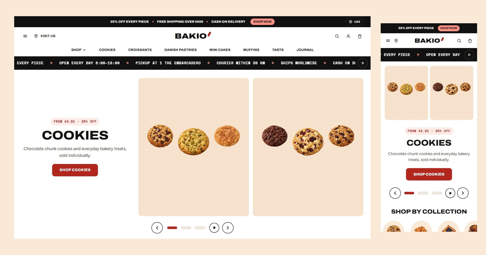
</p>

<h1 align="center">Mikio Ticker Patisserie</h1>

<p align="center">
  <b>A single bakery laid out like a busy cake counter: black bars, cream tiles, one cherry red, extended caps and a moving ticker.</b><br>
  A custom Selldone Layout built on the official <a href="https://github.com/selldone/storefront">selldone/storefront</a>.
</p>

<p align="center">
  <a href="https://mikio.selldone.shop"></a>
  <a href="https://github.com/selldone-custom-layouts/official-mikio/wiki"></a>
  <a href="https://github.com/selldone-custom-layouts/official-mikio/wiki/Install-with-AI"></a>
  
  
  
</p>

<p align="center">
  <a href="https://mikio.selldone.shop"><b>Open the live shop</b></a> ·
  <a href="https://github.com/selldone-custom-layouts/official-mikio/wiki/Install-with-AI">Set it up with AI</a> ·
  <a href="https://github.com/selldone-custom-layouts/official-mikio/wiki/Manual-Setup">Manual setup</a> ·
  <a href="https://github.com/selldone-custom-layouts/official-mikio/wiki/Shop-Requirements">What your shop needs</a> ·
  <a href="https://github.com/selldone-custom-layouts">All Selldone custom layouts</a>
</p>

---

## What it is

**Mikio Ticker Patisserie** lays a single pâtisserie out like a busy cake counter, after the page structure of a well-known American dessert shop's online store: a black announcement bar, a centred wordmark with a row of collections, a moving strip of the shop's real facts, a slider of two-photo collection spreads, rails of cream-tile cards with **Add to bag**, the delivery ways as photo tiles, an icon band, journal features and a black footer. It was drawn for **Bakio**, a bakery that sells individual pastries for courier delivery, worldwide shipping and pickup, paid in cash on delivery.

- white pages, black bars and footer, cream image tiles (`#fbe9d7`) under every pastry;
- **one** cherry red `#b3261e` for every action (buttons, chosen states, links);
- heavy extended caps (Archivo) for headings, buttons and the nav, Figtree for reading, Space Mono for the moving strip, kickers and stickers;
- flat buttons, hover changes the colour only, no line under any word or icon, selection rings inside the box;
- light by default, with a warm-black dark mode; a **Theme** row in the footer on the showcase shop: five palettes (Cherry, Caramel, Pistachio, Blueberry, Licorice), a **Custom colour** and Light / Dark;
- it says **bag**, never cart; every word it writes is in English and Arabic (right to left).

It runs on **[mikio.selldone.shop](https://mikio.selldone.shop)**, one domain of the Selldone shop Bakio (Selldone lets each domain of a shop carry its own Layout; the shop's other addresses keep theirs).

Everything is read live from the shop: its title (drawn as the wordmark), collections, products, prices and savings, sales (for the slider and best sellers), delivery ways and their time windows, the pickup counter and its hours, the way to pay, the articles. Nothing about Bakio is written in the code, so another bakery that imports the Layout gets its own data. Selldone's own bag, checkout, payments and orders keep working underneath.

## Screenshots

| Desktop | Phone |
| --- | --- |
| 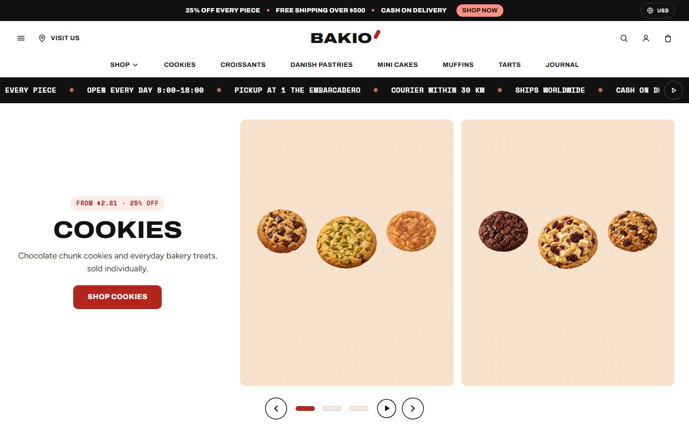 | 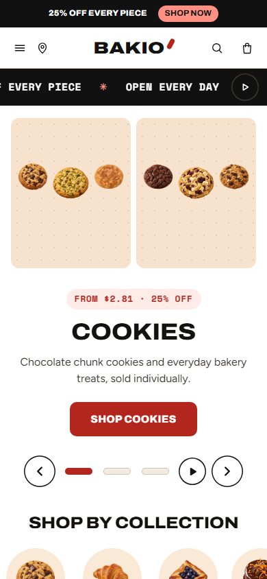 |
| 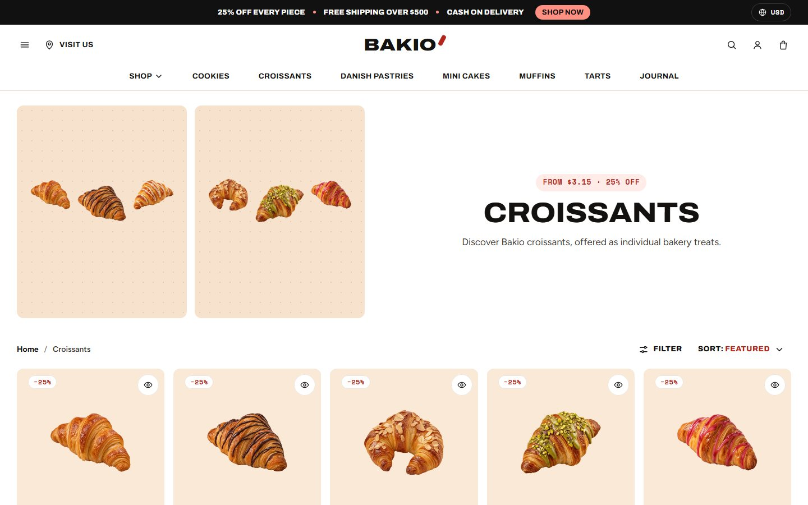 | 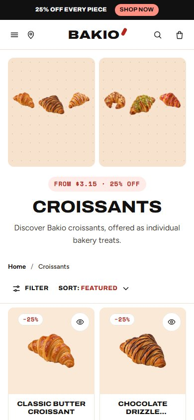 |
| 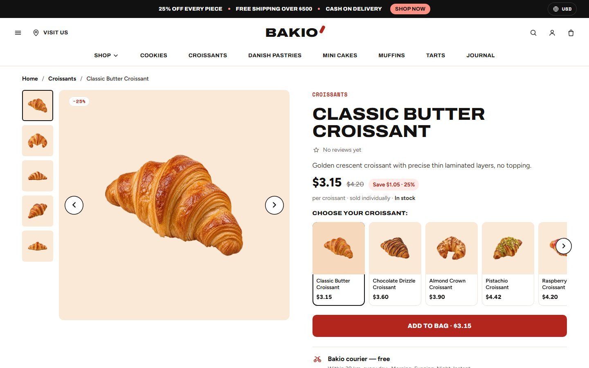 | 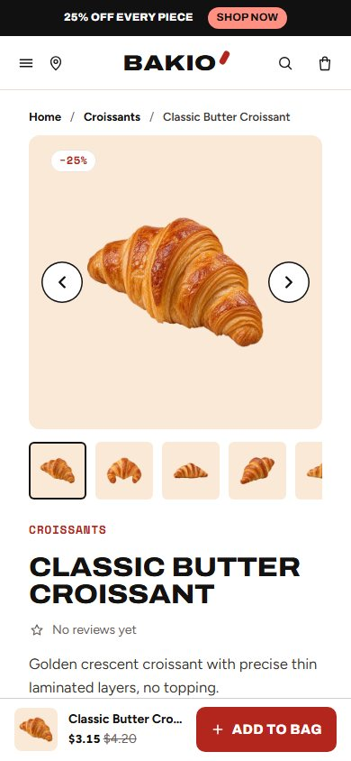 |
| 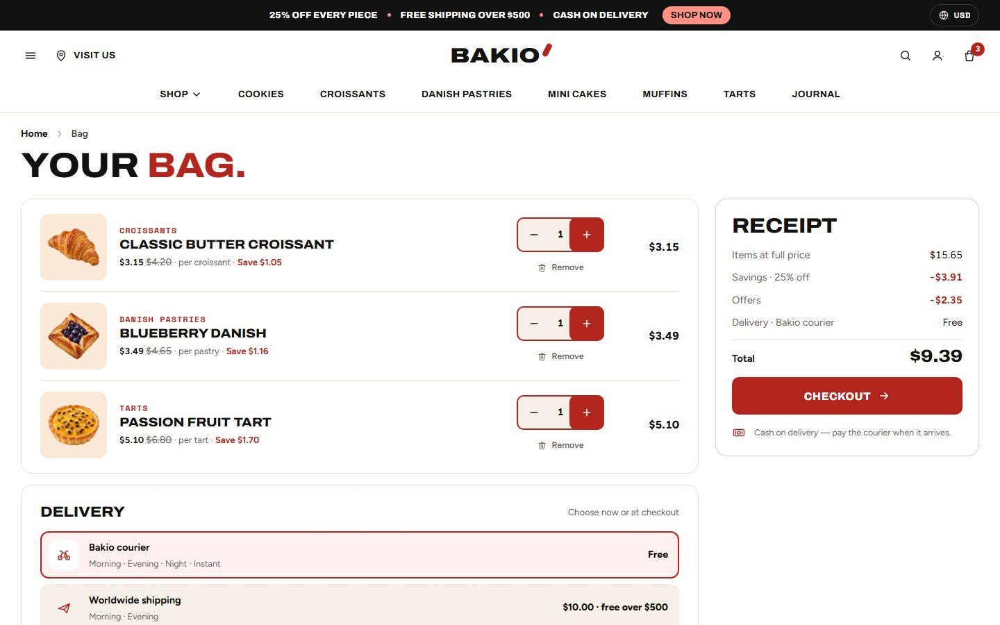 | 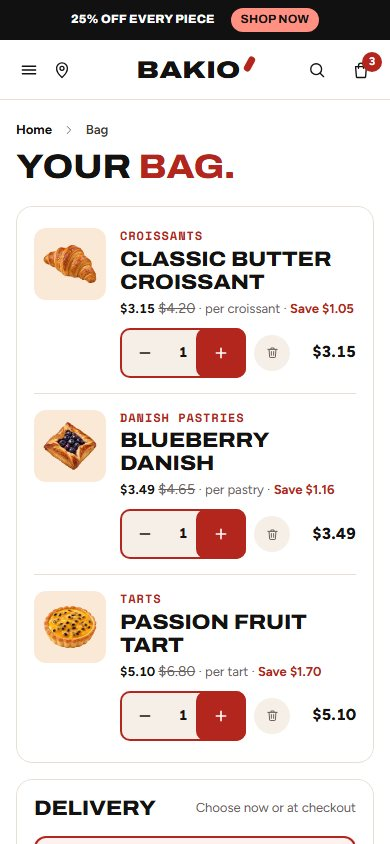 |

| Dark mode (desktop) | Dark mode (phone) | The Theme row (footer) |
| --- | --- | --- |
| 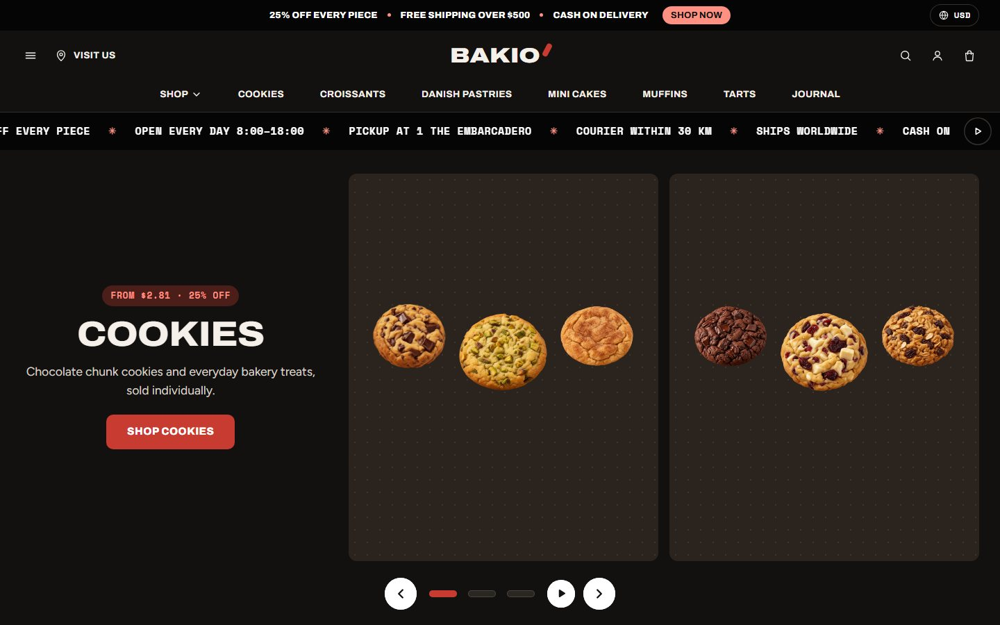 | 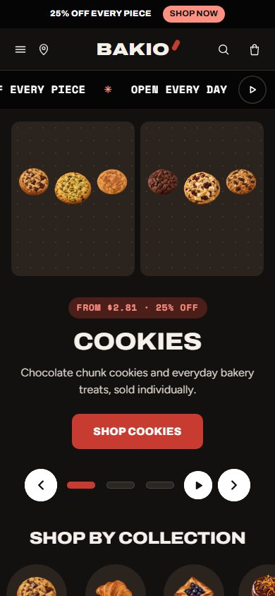 | 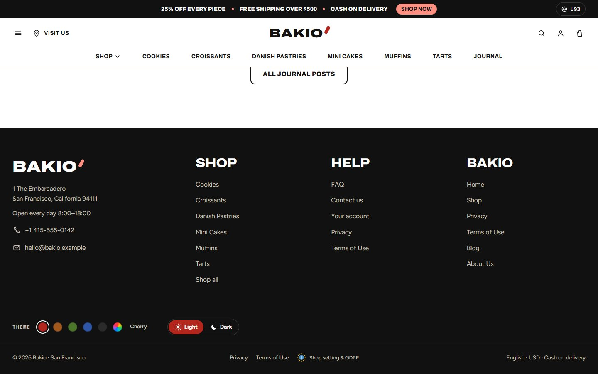 |

## Highlights

- **Header:** a black announcement bar (the saving every piece has, the free-shipping threshold, the way to pay, **Shop now**, and the language and currency pill); a white bar that sticks, with the menu and **Visit us** (the pickup counter: street, days and hours, phone, directions) on the left, the wordmark in the centre, search, account and the bag with its count on the right; a centred row of the collections with **Shop ⌄**, a photo menu of every collection and Shop all that opens on hover too. The menu panel holds the collections, the shop's pages, the counter's details and a "Language & currency" sheet.
- **Home:** a moving strip of the shop's facts (with a pause button; still for reduced motion); a slider of the three collections with the most pieces sold, each with two portrait photos, filling tabs, pause / play, arrows, swipe and arrow keys; the collections as round tiles with "from" prices; **Just added** (the newest piece of each collection in turn); **One piece at a time**; **Three ways to get it** (the shop's delivery ways as photo tiles); **Good to know** (pay on delivery, guest checkout, the courier's windows: each only when the shop has it); a strip of the collections; **Best sellers**; the two newest journal posts side by side; **Up close** (the first reason to love three more collections' best sellers); the shop's story; the journal last.
- **Photos:** every photo slot (the slider, One piece at a time, the delivery tiles, the story, each collection page's hero) shows the shop's own photo when the Layout has one, else three real cut-outs of the collection on a dotted cream ground. Ready-made prompts for each photo are in the design folder (no words, logos or people on any photo).
- **Collection page:** the collection's two-photo hero with its "from" price, name and description; a slim bar with the breadcrumb, **Filter** and **Sort**; the grid of cards, five across on wide screens, with one dark band after the first full row; **Order by the piece. Here's how it works.**; delivery questions answered from the shop's own delivery ways; **More collections**. Search and Shop all share the grid with a short head and collection tabs.
- **Filters:** a side panel at every width: real spec filters (a key becomes a filter only when it has two or more short values; no filter is invented), a price range with short boxes, On offer; a calm loading fade.
- **Card:** the cut-out on a cream tile with a −% sticker and a quick-look eye, the name in caps, the first reason to love it, the price, the struck was-price and "per <unit>", then **Add to bag** across the card, which turns into "− n +" in place.
- **Product page:** a gallery (thumbnails beside one big tile, arrows) that stays in view; the collection, the name, the honest reviews line, the first reason to love it, the price and the saving; **Choose your <unit>:** — the collection's other pieces as photo tiles; options only when the product has real variants; **Add to bag · $x**; the delivery, pickup and payment lines; rows that open (why you'll love it, each spec group); Compare and Copy link. Then **Goes well with**, the reviews, **More <collection>** and more collections; a buy bar on a phone.
- **Bag and checkout, orders and account, pages:** the bag drawer, the bag page, the checkout (step pills, contact, delivery way cards with the shop's windows, address sheet, billing, note, Selldone's payment window), the order page with its chat, the desk account, the journal and articles, About, Terms, Privacy, FAQ, Contact and a 404 inside the Layout — all in the same caps-and-cream dress.
- **Footer:** the wordmark with the shop's street, hours, phone and email, Shop, Help and the shop's own footer menu, the Theme row and a legal row with Selldone's cookie settings.

## Tests

Every check runs one browser at a time against the live shop, at 1440px and 390px, dark and light, a custom yellow brand colour and Arabic (right to left). Each is delivered at **TOTAL 0**.

<!-- TESTS:START -->
Live shop **mikio.selldone.shop**, 13–14 November 2026 (`bash scripts/run-checks.sh https://mikio.selldone.shop <logs>`): every check on 1.0.0, then the ones that had findings again on 1.0.1, where they are 0.

| Check | What it looks for | Where | TOTAL |
| --- | --- | --- | --- |
| Ring sweep (dark, light, Arabic) | every selection ring and edge drawn inside its box | 16 pages (home, collection, Shop all, search, two products, compare, journal, About, Terms, Privacy, Contact, FAQ, 404, bag, account), 8 in Arabic | **0** |
| Card edge (kit, dark, light) | no card's content touching its edge | home, collection, search, Shop all, journal, About, FAQ, Contact | **0** |
| Corner clear | the quick-look eye on a card never on or touching words | 8 pages, 390 to 1920px | **0** |
| Circle fit (long prices, Arabic) | the words in any circle stay inside it | home, Shop all | **0** |
| Contrast (dark, light, yellow brand, Arabic) | every word at 4.5:1 or better on what is really behind it | 16 pages, 8 for yellow and Arabic | **0** |
| Contrast with layers open | the bag drawer or the menu panel open, the sign-in sheet open | home | **0** |
| Bag audit (dark, light) | the drawer, the bag page and the address sheet | 1440 and 390 | **0** |
| Currency | every price, filter and total follows the picked currency at once | home, collection, product, Shop all, drawer, menus | **0** |
| Box check (dark, light, Arabic) | no photo over words, icon rows aligned | every page and open state | **0** |
| Underline (dark, light) | no line under any word or icon, at rest or on hover | 8 pages | **0** |

On 1.0.0 two causes had findings, both fixed in 1.0.1: the footer's Theme row and Selldone's legal-row link kept the page's dark words on the black footer in light mode, and About's address block shared a class name with the header's "Visit us" button, so its map covered the page. The mockups (every page at 1440, 1100, 768, 390 and 360, light and dark, with their menus, panels and sheets open) were checked the same way before the build.
<!-- TESTS:END -->

## Languages

Every word Mikio writes goes through `t("key", "English")` ([`components/kalio/i18n/`](components/kalio/i18n/)): the shared words in `base/<lang>.ts`, the Layout's own in `bakini.<lang>.ts` (Mikio's new words under `bakini.mk.*`). Arabic loads only when a visitor picks it and turns the whole page right to left. The wiki page [Customize](https://github.com/selldone-custom-layouts/official-mikio/wiki/Customize) has the steps for another language.

## Theme and colours

Mikio runs the shared theme switcher (`components/theme-switcher/`, the same code as the other custom Layouts). On your own shop the visitor switcher is hidden, and Mikio shows the theme you set in **one file**, [`components/bakini/bakini-theme.settings.ts`](components/bakini/bakini-theme.settings.ts): a palette (`cherry`, `caramel`, `pistachio`, `blueberry`, `licorice`) or any brand colour (`brandColor: "#F5C400"`; a light colour keeps dark words on it with `textOnBrand: "auto"`), `light` or `dark`, and whether your visitors get the switcher (`themeSwitcher: "showcase" | "on" | "off"`). Every colour is made readable automatically. An AI agent finds the steps in the "Theme" section of [`AGENTS.md`](AGENTS.md).

## Use it on your shop

| You want to… | Read |
| --- | --- |
| Let an AI agent (Claude Code, Codex…) set it up for your shop | [Install with AI](https://github.com/selldone-custom-layouts/official-mikio/wiki/Install-with-AI) |
| Do it yourself, step by step | [Manual Setup](https://github.com/selldone-custom-layouts/official-mikio/wiki/Manual-Setup) |
| Know what data your shop needs for the design to look right | [Shop Requirements](https://github.com/selldone-custom-layouts/official-mikio/wiki/Shop-Requirements) |
| Build, upload and verify a release | [Build and Upload](https://github.com/selldone-custom-layouts/official-mikio/wiki/Build-and-Upload) |
| Put the Layout live on your shop, or on one domain of it | [Go Live](https://github.com/selldone-custom-layouts/official-mikio/wiki/Go-Live) |
| Change the name, sections, pages, photos or languages | [Customize](https://github.com/selldone-custom-layouts/official-mikio/wiki/Customize) |
| Change the colours, dark or light, the visitor switcher | [Theme and colours](https://github.com/selldone-custom-layouts/official-mikio/wiki/Theme-and-colours) |
| Fix a blank page, a rejected upload or an old version showing | [Troubleshooting](https://github.com/selldone-custom-layouts/official-mikio/wiki/Troubleshooting) |

The wiki's source is also in [`docs/wiki/`](docs/wiki/).

## Quick start (developers)

```bash
git clone https://github.com/selldone-custom-layouts/official-mikio.git
cd official-mikio
npm run setup            # the six Selldone modules (modules/)
for p in components translate; do git -C modules/$p apply ../../patches/modules-$p.kalio.patch; done
npm install --force
npm run serve            # dev server on http://localhost:9147, reading the shop named in .env
```

`.env` names the shop the dev server reads (`VITE_APP_SAMPLE_SHOP_NAME=bakio`). Releases:

```bash
LAYOUT_ID=<your Layout id> SELLDONE_CLI_SRC=<cli clone> bash scripts/release.sh <new version> desk
```

Leave `LAYOUT_ID` out on the first upload; use the id printed after it from then on. Never reuse a version number. Keep the build under about 360 files (the release script prints the count).

## Where things are

| Area | Files |
| --- | --- |
| Your theme (palette, brand colour, mode, switcher) | [`components/bakini/bakini-theme.settings.ts`](components/bakini/bakini-theme.settings.ts) |
| The mockup's stylesheets and tokens, scoped to `.nx` (generated by [`scripts/mikio-css.cjs`](scripts/mikio-css.cjs)) | [`style/mikio/`](style/mikio/) |
| The Layout's own touches | [`style/mikio-layout.scss`](style/mikio-layout.scss) |
| Home, photo slots, the bands under listings | [`components/mikio/`](components/mikio/) (`MkHome.vue`, `MkPhoto.vue`, `mikio-photos.ts`, `MkBands.vue`) |
| The shop's photos (optional; the slots fall back to cut-outs) | `assets/mikio/<file>.webp`, names in `mikio-photos.ts` |
| Header and footer | [`components/bakini/shell/`](components/bakini/shell/) |
| Card, rail, quantity box, bag drawer, quick look, shared data and layers | [`components/bakini/noir/`](components/bakini/noir/) (`noir.ts`, `Nx*.vue`) |
| Collections, search, Shop all (filters and sort) | [`components/bakini/noir/shop/NxListing.vue`](components/bakini/noir/shop/NxListing.vue), [`pages/products/`](pages/products/) |
| Product page and compare | [`components/bakini/noir/product/`](components/bakini/noir/product/), [`components/bakini/noir/compare/`](components/bakini/noir/compare/), [`pages/product/`](pages/product/) |
| Bag, checkout, order, account | [`components/bakini/noir/buy/`](components/bakini/noir/buy/), [`components/bakini/noir/account/`](components/bakini/noir/account/), [`pages/basket/`](pages/basket/), [`pages/user/`](pages/user/) |
| Journal, article, About, Terms, Privacy, FAQ, Contact, 404, sign-in | [`components/bakini/noir/read/`](components/bakini/noir/read/), [`pages/blog/`](pages/blog/), [`pages/official/`](pages/official/), [`pages/faq/`](pages/faq/), [`pages/errors/`](pages/errors/) |
| The wordmark, from the shop's title | [`components/bakini/BakiniLogo.vue`](components/bakini/BakiniLogo.vue) |
| How the mockup became the Layout, data rules and releases | [`MIKIO.md`](MIKIO.md) |
| The checks | [`scripts/run-checks.sh`](scripts/run-checks.sh) and the tools it names |
| Release tooling | [`scripts/`](scripts/) |
| Selldone storefront's original README | [`README.selldone.md`](README.selldone.md) |

Mikio started from [Bakini Noir](https://github.com/selldone-custom-layouts/official-bakini) and keeps its buy flow, account and pages (the Kalio base: bag, checkout, account, compare; the theme and region switchers), dressed in Mikio's look; the header, footer, home, card, collection and product pages are Mikio's own.

## Credits and license

Built on the official [Selldone Storefront](https://github.com/selldone/storefront) (MIT License, © Selldone); see [`LICENSE.md`](LICENSE.md). Part of **[Selldone Custom Layouts](https://github.com/selldone-custom-layouts)**.
