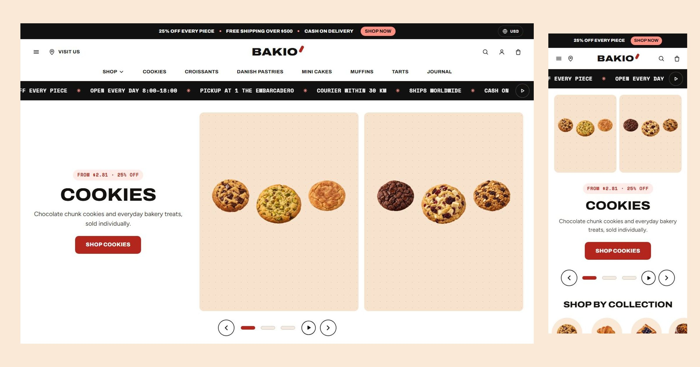
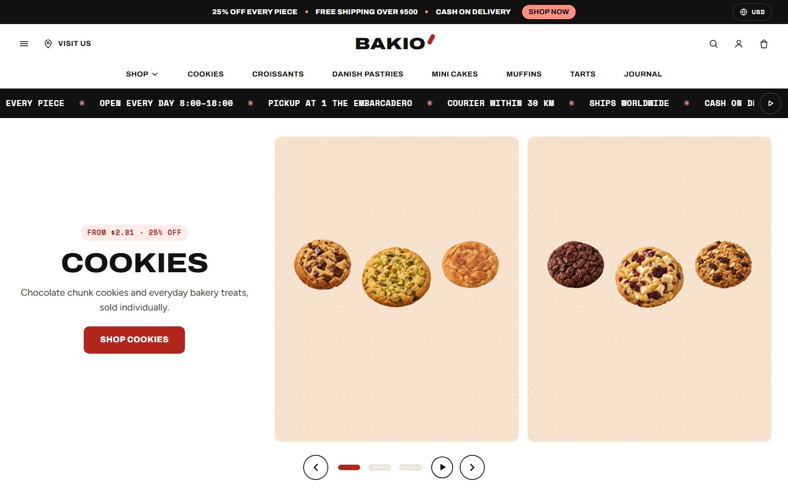
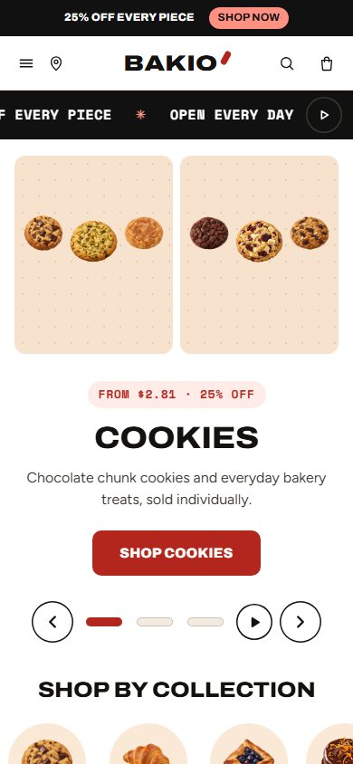
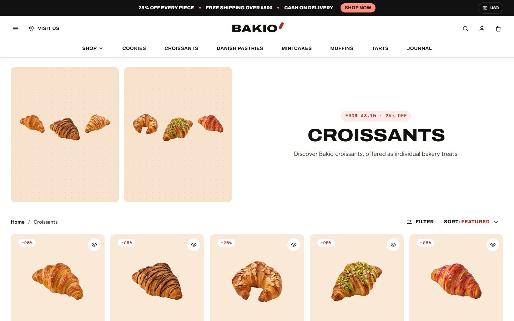
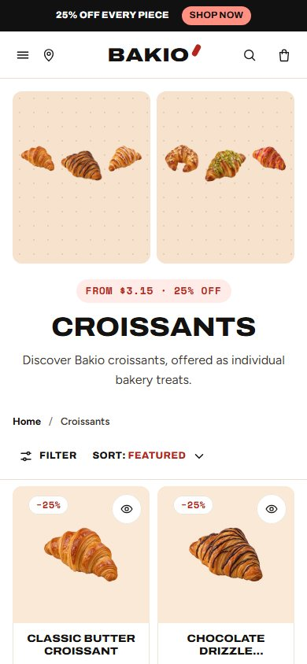
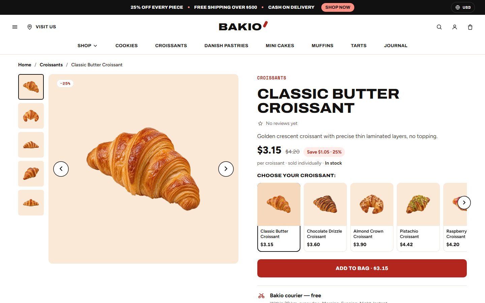
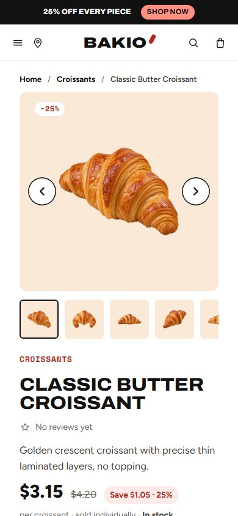
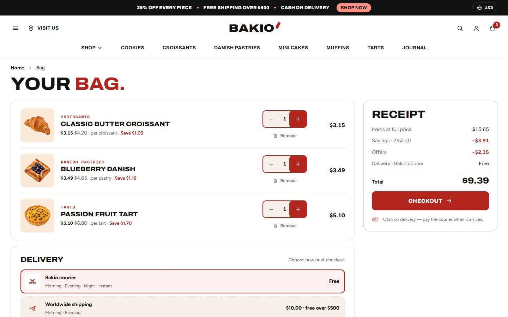
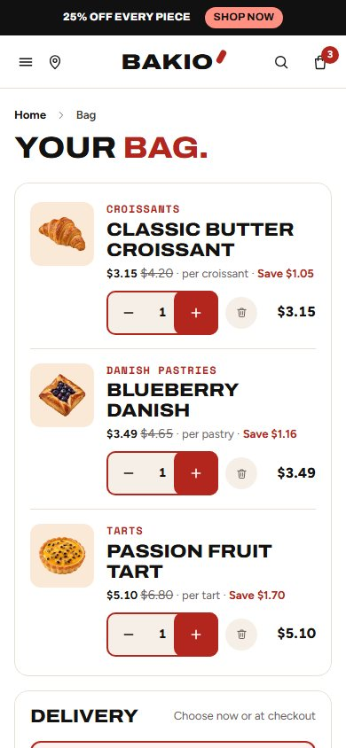

# Mikio Ticker Patisserie

**Mikio Ticker Patisserie** is a custom storefront **Layout** for Selldone shops: a single bakery laid out like a busy cake counter, after the page structure of a well-known American dessert shop's online store. White pages, black bars, cream tiles under every pastry, one cherry red for every action, heavy extended caps (Archivo) over Figtree, and Space Mono for the moving strip, kickers and stickers. A black announcement bar, a centred wordmark over a row of collections, a moving strip of the shop's real facts, a slider of two-photo collection spreads, rails of cream-tile cards with **Add to bag** and the delivery ways as photo tiles; collection pages with a two-photo hero and filters in a side panel; a product page with a gallery and the collection's other pieces as tiles; a bag drawer, the checkout, the order page, a desk account and a 404 inside the Layout. Light is the default, with a warm-black dark mode. It says **bag**, never cart. Every word it writes is in English and Arabic (right to left).

It runs on **[mikio.selldone.shop](https://mikio.selldone.shop)**, one domain of the Selldone shop Bakio. The shop's default address and its other domains carry a different Layout (Bakini Noir); Mikio is pinned on its own domain only (see [Go Live](Go-Live)). It is built on the official [selldone/storefront](https://github.com/selldone/storefront), so Selldone's basket, checkout, payments and orders keep working underneath a new design.

## Start here

| I want to… | Page |
| --- | --- |
| Have an AI agent set it up on my shop | **[Install with AI](Install-with-AI)** |
| Set it up myself | [Manual Setup](Manual-Setup) |
| Know what my shop's data needs | [Shop Requirements](Shop-Requirements) |
| Build, upload and verify a release | [Build and Upload](Build-and-Upload) |
| Put it live on my shop or one domain | [Go Live](Go-Live) |
| Change the name, sections, pages, photos, languages | [Customize](Customize) |
| Change the colours, dark or light, the visitor switcher | [Theme and colours](Theme-and-colours) |
| Fix a problem | [Troubleshooting](Troubleshooting) |

## How a Selldone Layout works (one minute)

1. A **Layout** is a complete storefront app (Vue 3) that runs on Selldone's own servers instead of the default storefront.
2. You build it, zip it, and **upload** it to your Selldone developer account with the official [selldone-cli](https://github.com/selldone/cli). Each upload is a new **version**.
3. You **attach** a version to your shop, or to one domain of it.
4. Selldone injects **your** shop into the Layout: its title, collections, products, prices, delivery ways, payment methods, articles, languages, currencies and settings. Nothing about Bakio is hard-coded: not the name (the wordmark is your shop's title), not a price, a delivery window or an opening hour. The only shop-specific files are the optional photos in `assets/mikio/`; without them every photo slot shows your own products. Another bakery that imports the Layout gets its own data.

## The look

| Part | Mikio |
| --- | --- |
| Grounds | white pages `#ffffff` with ink `#141210`; black bars `#111111` (the announcement bar, the moving strips, the footer); cream tiles `#fbe9d7` under every pastry and in the bands |
| Action colour | one cherry red `#b3261e` (white words 6.54:1): every button, chosen state and link. On the black bars, the palette's light red (`--bk-act-dk`, `#ff9082` for Cherry) with dark words, in both modes |
| Pastries | transparent cut-outs on cream tiles, with a `−%` sticker when there is a saving |
| Type and icons | Archivo, heavy and extended, in caps for headings, buttons, the nav and the wordmark; Figtree for reading; Space Mono for the moving strip, kickers and stickers; inline line icons |
| Buttons | flat; hover changes the colour only; no line under any word or icon; selection rings inside the box |
| Photos | photo slots on the home and on each collection page: your own photo when the Layout has one, else three real cut-outs on a dotted cream ground; no words on any photo |
| Theme | light by default; a warm-black dark mode (page `#121110`, cards `#1b1917`); five palettes (Cherry, Caramel, Pistachio, Blueberry, Licorice) and a custom colour; a visitor switcher (a footer row) on the showcase shop only (see [Theme and colours](Theme-and-colours)) |
| Languages | English and Arabic (right to left); the language and currency pill at the right end of the announcement bar |

## What you get

- **Header:** a black announcement bar (the saving every piece has, the free-shipping threshold, the way to pay, **Shop now**, and the language and currency pill). Under it a white bar that sticks: the menu button and **Visit us** (the pickup counter: street, days and hours, phone, Get directions) on the left; the wordmark (your shop's title in caps, with one tilted sprinkle) in the centre; search with live suggestions, the account and the bag with its count on the right. From 1100 px wide, a centred row with **Shop ⌄** (every collection with its best seller's photo, Shop all, and a strip with pickup and the saving; it opens on hover too), the collections themselves and Journal. The menu panel holds the collections, the shop's pages, the counter and a "Language & currency" row that opens a bottom sheet. On a phone: the menu button, Visit us, the wordmark, search and the bag; there is no bottom tab bar.
- **Footer:** a black band with the wordmark, the shop's street, city, days and counter hours, phone and email; Shop (every collection and Shop all); Help (FAQ, Contact us, your account, Privacy, Terms of Use); your footer menu under the shop's name; the Theme row (showcase only); the legal row (copyright and city, Privacy, Terms, Selldone's cookie settings, the language, currency and way to pay, social links).
- **Home,** in this order (a section without its data folds away):
  1. a moving strip of the shop's facts (sold by the piece, the saving, open days and counter hours, pickup, the courier's distance, worldwide shipping, the way to pay), with a pause button;
  2. a slider of the three collections with the most pieces sold, each with its "from" price, name, description, a **Shop <collection>** button and two portrait photos. It moves on by itself, holds on hover, keyboard focus and a hidden tab, and has filling tabs, pause / play, arrows, swipe and the arrow keys; with reduced motion it starts paused;
  3. **Shop by collection:** round tiles with "from" prices;
  4. **Just added:** the newest piece of each collection in turn;
  5. **One piece at a time:** one line and two photos;
  6. **Three ways to get it:** the shop's delivery ways as photo tiles with their windows or note and their fee;
  7. **Good to know:** pay on delivery, no account needed, pick a window (each only when the shop has it);
  8. a moving strip of the collections;
  9. **Best sellers;**
  10. the two newest journal posts side by side;
  11. **Up close:** the first reason to love the best sellers of three more collections;
  12. the story ("Hello from <city>.", with the hours, phone and email);
  13. **From the journal:** the next four posts.
- **Photo slots:** the slider (two per collection), One piece at a time, the three delivery tiles, the story and each collection page's hero. Each shows your photo from `assets/mikio/` when the Layout has one, else three real cut-outs on a dotted cream ground (see [Customize](Customize#photos)).
- **Collection page:** the collection's two-photo hero with its "from" price, name and description; a slim bar with the breadcrumb, **Filter** and **Sort**; the grid of cards, five across on wide screens, with one dark band after the first full row (how paying works); **Order by the piece. Here's how it works.**; delivery questions answered from your own delivery ways; **More collections**. Search and Shop all share the grid with a short head and collection tabs.
- **Filters:** a side panel at every width with real spec filters, a price range with short boxes and On offer. Sort: Featured, Best sellers, Customer review, Price low to high, Price high to low, Newest.
- **Cards:** the cut-out on a cream tile with a `−%` sticker and a quick-look eye, the name in caps, the first reason to love it, the price with the struck was-price and "per <unit>", then **Add to bag** across the card, which turns into "− n +" in place.
- **Product page:** a gallery (thumbnails beside one big cream tile, arrows) that stays in view; the collection, the name, the reviews line, the first reason to love it, the price and the saving; **Choose your <unit>:** (the collection's other pieces as photo tiles); options only when the product has real variants; **Add to bag · $x**; the delivery, pickup and payment lines; rows that open (Why you'll love it, each spec group); Compare and Copy link. Then **Goes well with**, the reviews (an honest empty state with your rating criteria until the first review), **More <collection>** and **More collections**; a buy bar on a phone.
- **Compare and quick look:** the picks side by side with differences marked; a quick look dialog (a bottom sheet on a phone).
- **Bag and checkout:** a bag drawer with "Often added", the bag page, then the checkout: step pills, contact, delivery method cards with your time windows, an address sheet (with or without a map), billing, a note and Selldone's payment window. Without a payment method it says plainly that the shop is not taking payment.
- **Orders and account:** the order page (receipt, delivery and a chat with the shop); the account as a desk (Overview, Orders, Addresses, Profile) where each order shows its steps (Placed, Baking, On the way, Delivered); a sign-in sheet.
- **Content pages:** the journal and each story (a panel with the pastries the story links to and "Add all"), About, Terms, Privacy, FAQ, Contact and a 404 inside the Layout.

The bag, checkout, order, account and content pages are Bakini Noir's components, unchanged in markup and dressed in Mikio's styles; the header, footer, home, cards, collection and product pages are Mikio's own.

## Screens

| Desktop | Phone |
| --- | --- |
|  |  |
|  |  |
|  |  |
|  |  |

## Links

- Live shop: <https://mikio.selldone.shop>
- Repository: <https://github.com/selldone-custom-layouts/official-mikio>
- What Mikio is, how the pages were built, its data rules and releases: [`MIKIO.md`](https://github.com/selldone-custom-layouts/official-mikio/blob/main/MIKIO.md); shared behaviours: [`KALIO.md`](https://github.com/selldone-custom-layouts/official-mikio/blob/main/KALIO.md)
- All official custom Layouts: <https://github.com/selldone-custom-layouts>
- Selldone: <https://selldone.com>
