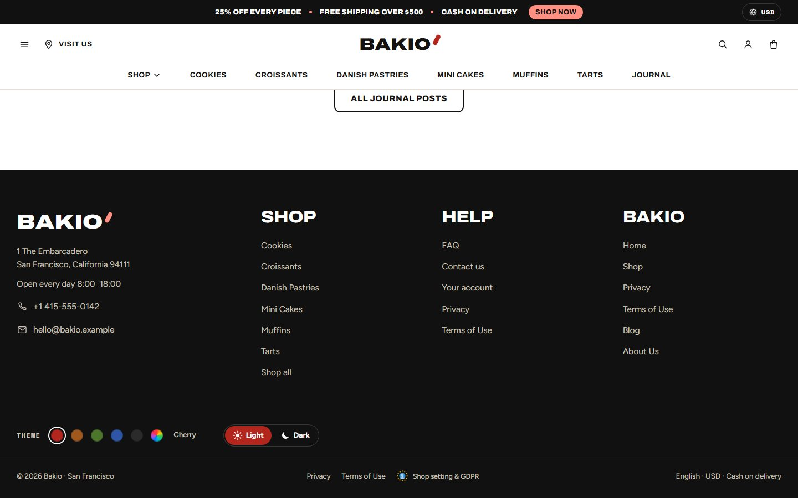
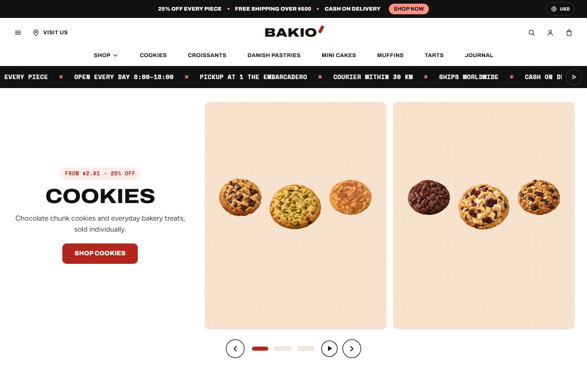
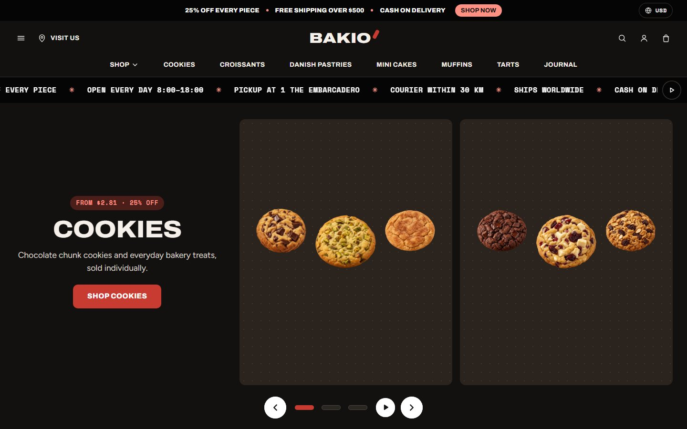
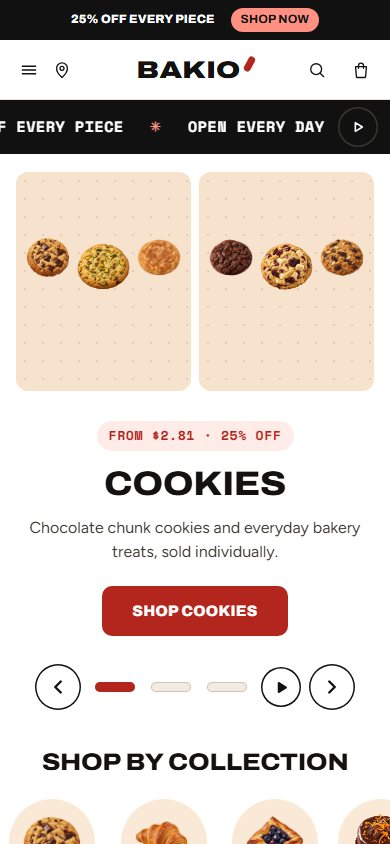
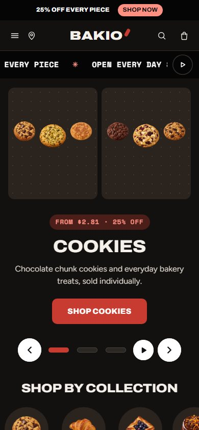

# Theme and colours

Mikio runs the **shared theme switcher** (`components/theme-switcher/`), the same code as the other custom Layouts. Mikio's palettes are in `components/bakini/bakini-theme.ts` and its grounds, lines and words for both modes in `style/mikio/tokens.css` (generated from the mockup by `scripts/mikio-css.cjs`); the **one file a merchant edits** is `components/bakini/bakini-theme.settings.ts`.

## Mikio's colours

Mikio paints every action with **one colour**, cherry red `#b3261e` (white words 6.54:1): every button, chosen states and links.

Around it, in the light mode (the default): white pages `#ffffff`, ink `#141210`, muted words `#6a625b`, lines `#e7dfd6`, cream tiles and bands `#fbe9d7`, and black bars `#111111` with white words (the announcement bar, the moving strips, the footer). On the black bars, the palette's light text colour (`--bk-act-dk`; `#ff9082` for Cherry) marks the "Shop now" pill, the moving strips' stars and the footer's sprinkle, with dark words `#111111` on it, in both modes. In the warm-black dark mode: the page `#121110`, cards `#1b1917`, raised parts `#26221f`, words `#f5f0ea`, muted words `#a99f95`, tiles `#2a231e` and the bars `#050505`. Every colour is a token in `style/mikio/tokens.css` (`html:root` is light, `html.bk-dark:root` is dark).

The mode from the settings file (light by default) is painted before the first paint on every shop, so the other mode never flashes.

## On Mikio's showcase shop



The **Theme** row sits in the footer, in a band of its own above the legal row. It is never in the header. It holds:

- **Colour:** Cherry (the default), Caramel, Pistachio, Blueberry, Licorice, and **Custom colour** (any colour from the browser's colour picker; it is made readable in light and dark against Mikio's own surfaces, with a note "Adjusted for readability" when it had to change).
- **Mode:** Light or Dark.

One click changes the whole site at once, with no reload: Mikio's colours, the Kalio base, Vuetify's theme and Selldone's own parts (the buy button, prices, the bag drawer, the checkout sheets, dialogs). The choice is kept in the browser (key `mikio-theme`; dark mode is the class `bk-dark` on `<html>`) and painted before the first paint, so the default never flashes. The arrow keys (and Home / End) move between the swatches.

| Light (the default) | Dark |
| --- | --- |
|  |  |
|  |  |

## On your own shop

The visitor switcher is a **showcase** feature. With `themeSwitcher: "showcase"` it shows only on the Layout's own showcase shops (listed in `showcaseShops` in `components/bakini/bakini-theme.ts`). On any other shop it is not shown, nothing is read from or written to the browser's storage, and Mikio shows the theme from the settings file:

```ts
export const THEME_SETTINGS: ThemeSettings = {
  palette: "cherry",         // "cherry" | "caramel" | "pistachio" | "blueberry" | "licorice"
  // brandColor: "#F5C400",  // any colour; replaces palette
  mode: "light",             // "light" | "dark"
  themeSwitcher: "showcase", // "showcase" | "on" (your visitors get it) | "off"
  textOnBrand: "auto",       // with brandColor: "auto" (a light brand keeps dark words) | "white"
};
```

| Setting | Allowed values |
| --- | --- |
| `palette` | `"cherry"` (the brand; the default), `"caramel"`, `"pistachio"`, `"blueberry"`, `"licorice"` |
| `brandColor` | any `"#RRGGBB"`; when set it replaces `palette` |
| `mode` | `"light"` (white pages; the default) or `"dark"` (warm black) |
| `themeSwitcher` | `"showcase"` (the visitor switcher shows only on the Layout's own showcase shops; the default), `"on"` (your visitors get the Theme row in the footer), `"off"` |
| `textOnBrand` | only with `brandColor`: `"auto"` (a light brand such as yellow keeps its colour, with dark words on it) or `"white"` (white words; a light colour is darkened) |

Every colour is made readable automatically: buttons, links, chosen states and dark mode.

## Examples

Change only these lines; leave the rest of the file as it is.

| You want | Set |
| --- | --- |
| "Use the yellow theme" | No palette is yellow, so use a brand colour: `brandColor: "#F5C400", textOnBrand: "auto"` |
| "My brand colour is #F5C400" | `brandColor: "#F5C400", textOnBrand: "auto"`; use `textOnBrand: "white"` for white words (the colour is then darkened) |
| "Make it dark" | `mode: "dark"` |
| "Let visitors switch themes" | `themeSwitcher: "on"` |
| "Remove the switcher" | `themeSwitcher: "off"` (on your own shop it is already hidden with `"showcase"`) |
| "Go back to the original colours" | remove `brandColor`, set `palette: "cherry", mode: "light"` |

Then build and upload a new version and put it live:

```bash
LAYOUT_ID=<your Layout id> SELLDONE_CLI_SRC=<cli clone> bash scripts/release.sh <new version> desk
```

See [Build and Upload](Build-and-Upload) and [Go Live](Go-Live).

## Contrast

| Palette | Light: action colour, white words on it | Dark: action colour, white words on it | Dark: text colour on the card `#1b1917` |
| --- | --- | --- | --- |
| Cherry | `#b3261e` 6.54:1 | `#c73b30` 5.13:1 | `#ff9082` 7.98:1 |
| Caramel | `#a1581d` 5.34:1 | `#a35a1f` 5.20:1 | `#ec9d65` 7.99:1 |
| Pistachio | `#4c762a` 5.34:1 | `#4f7a2e` 5.05:1 | `#8dbc6e` 7.97:1 |
| Blueberry | `#2f56a6` 6.99:1 | `#436bbe` 5.14:1 | `#85afff` 7.99:1 |
| Licorice | `#2b2b2b` 14.16:1 | `#6d6d6d` 5.17:1 | `#aeaeae` 7.90:1 |

Each palette's dark text colour is also its `--bk-act-dk` on the black bars, where it reads at 8.5:1 or more against `#111111`, with dark words `#111111` on it at the same ratio. In light mode every action colour reads at 4.5:1 or more as text on the cream tile, ink at 18.7:1 on white, and muted words at 5.98:1 on white and 5.05:1 on the cream tile; in dark mode words read at 15.5:1 and muted words at 6.74:1 on the card. A custom or brand colour goes through `paletteFromColor()`, which moves only its lightness until each role reads against Mikio's surfaces (white, the cream `#fbe9d7` and `#f6efe8` in light; `#121110`, `#1b1917` and `#26221f` in dark).

## Checks

Run these from the repository root after a theme change. They need Playwright; set `PW` to your install (`PW=<path>/node_modules/playwright`) if the default path is not yours. `".ftr"` is the footer, which every page shows once it is ready.

1. **Contrast** on the live shop, at desktop and phone width. It must print `TOTAL 0`:
   ```sh
   PAGES="home=/,category=/<a category>,product=/product/<id>" \
     node components/theme-switcher/tools/contrast-audit.cjs https://<your shop> ".ftr"
   ```
   To test one palette and mode, add `STORAGE='{"mikio-theme":"{\"palette\":\"cherry\",\"mode\":\"dark\"}"}'` (this works where the switcher is shown).
2. **Bag drawer, bag page and address sheet.** It must print `TOTAL 0`. It fills a bag in the browser only and blocks every order request. The palette argument is a palette id, or `custom:#rrggbb` for a custom colour:
   ```sh
   SHOP=<your shop's xapi name> STORAGE_KEY=mikio-theme WAIT=".ftr" CART=".bag-btn" \
     node components/theme-switcher/tools/cart-audit.cjs https://<your shop> cherry light
   ```
3. **Underlines and boxes.** No line under any word or icon, at rest or on hover; photos never on words, icon rows aligned. Each must print `TOTAL 0`:
   ```sh
   PAGES="home=/,category=/<a category>,product=/product/<id>" node scripts/underline-check.cjs https://<your shop> ".ftr"
   SHOP=<your shop's xapi name> PAGES="home=/,category=/<a category>,product=/product/<id>" \
     node scripts/box-check.cjs https://<your shop> ".ftr"
   ```
   Both default to the showcase shop's pages, so always pass `PAGES` (and `SHOP` for the box check, which also opens the menus, a quick look and the bag).
4. **Colour maths:** `node components/theme-switcher/theme-color.test.mjs` (Node 22.6 or newer).

On Mikio's showcase shop the same checks run with `https://mikio.selldone.shop`, `SHOP=bakio`, `PAGES="home=/,category=/croissants-category,product=/product/720375"`, for each palette in light and dark; `scripts/run-checks.sh` runs the whole set there, one browser at a time.
